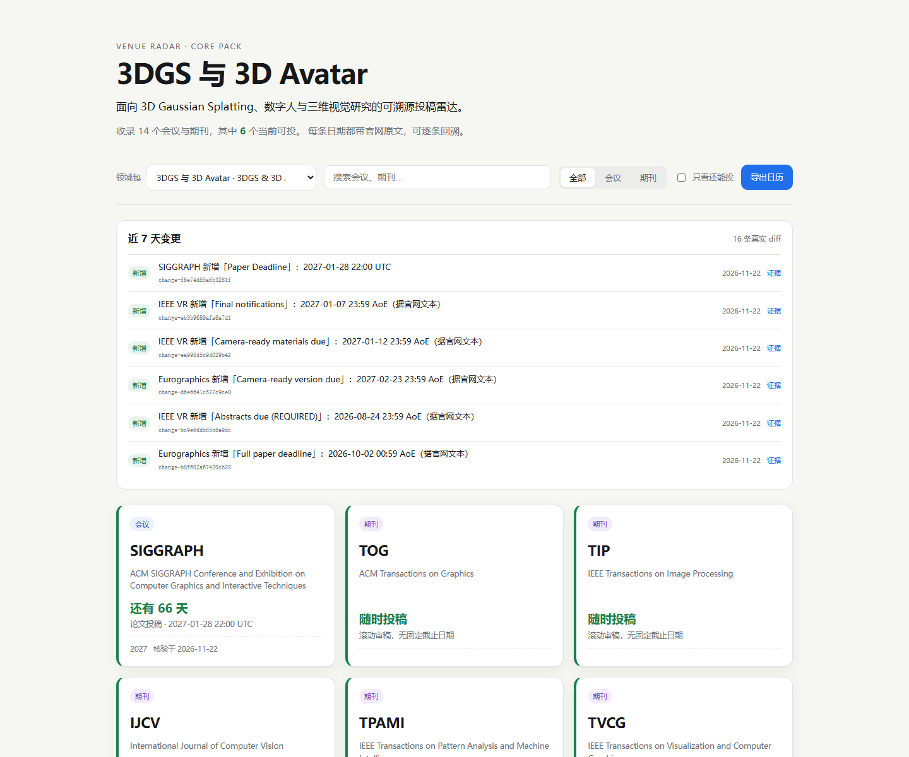
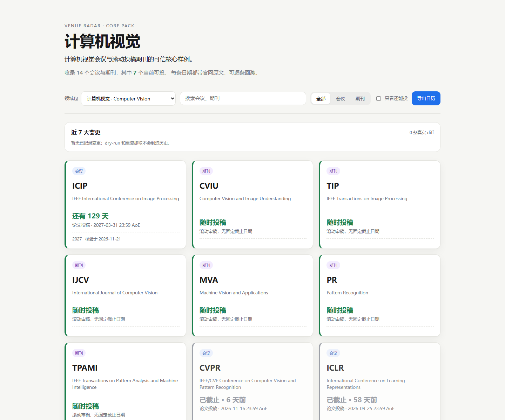

# Venue Radar

English | [中文](README.md)

**An open-source, self-hostable conference and journal radar for any research field.** It turns official deadline pages into a queryable, verifiable and subscribable dataset that you or your own agent can maintain.

> **Venue Radar is not a computer-vision product.** Computer Vision and 3DGS / Avatar are bundled examples: one shows breadth, the other shows how deep a vertical pack can go. Medical CV, HCI, robotics, computational biology or any other field can use the same mechanism with its own field pack.

<p align="center">
  
</p>

<p align="center"><em>The homepage answers three questions at once: what can I submit to next, what changed recently, and where is the evidence?</em></p>

---

## What it actually solves

Finding conference names is easy. Keeping their deadlines usable is not:

- Which conferences or journals in my field are **still open in the next three months**?
- The deadline was November 16 last week — **has it been extended**?
- **Which official page and line did this date come from**, and when was it checked?
- How do I get the same deadlines into **Windows / Outlook / Google Calendar**?
- When I switch topics next year, can I **reuse the same system**?

Venue Radar turns those questions into data, collectors, validators, a web UI, a CLI and calendar files in a Git repository — not a one-off chat answer.

---

## What is in the repository

| Component | Purpose |
|---|---|
| `data/venues/*.yaml` | The actual data: one YAML per venue, with editions and deadline nodes |
| `data/snapshots/` | Content-addressed snapshots of official pages, used to verify `evidence.quote` verbatim |
| `data/fields/*.yaml` | Field packs: declare which venues a field cares about, without duplicating dates |
| `sources/registry.yaml` | Official source page and fetch cadence for each venue |
| `acquire/` + `cmd/update.ts` | Fetch, snapshot, extract, diff, write back and record changes |
| `core/` | Schema, timezone conversion, query engine, deterministic filters, change summaries |
| `src/` | React shelf UI with switchable field packs |
| `cmd/` + `mcp/` | CLI and MCP query layer for scripts and agents |
| `skills/` + `docs/AGENT_ONBOARDING.md` | Bring-your-own-agent onboarding guide and copyable skill |

**In one sentence: the data is not model memory. It is reviewable Git content. Models may find, read and draft; they cannot bypass the evidence gates and write a date.**

---

## Why not just ask an agent?

If you only need a one-off answer to “when is the CVPR deadline?”, **asking an agent directly is easier**. Venue Radar is not a better chatbot. It addresses a different problem: **submission intelligence that is reused, trusted, shared and change-aware.**

| | Asking an agent directly | Venue Radar |
|---|---|---|
| Source of truth | Model memory plus ad-hoc search; usually not reproducible | Fixed official `sources/registry.yaml` plus content-addressed snapshots |
| Date credibility | May mix stale information, aggregators or guesses | Every date needs an official `quote` that matches a snapshot verbatim |
| Change awareness | A later question may not reveal what changed in between | `changelog` records real `added` / `changed` / `removed` events |
| Persistence | The answer disappears with the conversation | YAML stays in the repo; queryable, diffable, forkable |
| Team review | Hard to review why the answer looked plausible | The PR diff is the review surface |
| Calendar | Usually copied by hand | Export the current filter as `.ics`; subscribe to build artifacts |
| Model replacement | Prompts and behaviour may drift | The data contract and validators stay the same; swap the agent |
| New fields | Explain the context again every time | Create a field pack once and reuse the same venue data |

**Use Venue Radar when** a lab or team needs a trustworthy submission calendar, you submit to the same venues every year, or you want an agent to extend a new field without inventing dates.

**Do not use it for** “which journal is easier to get into?”, “which conference is more prestigious?” or “where should my paper go?”. Those require review culture, impact metrics, acceptance rates and advisor preferences. This repository **does not provide them, and does not pretend to**.

---

## A complete walkthrough for a medical CV researcher

Suppose you work on medical image segmentation and want to track MICCAI, MIDL, IPMI, ISBI, IEEE TMI and Medical Image Analysis over time. This is the actual workflow.

### 1. Clone the repository and open it

```bash
git clone https://github.com/qianlian-mozi/conference_journal_tool.git venue-radar
cd venue-radar
npm install
npm run dev
```

Open `http://localhost:5173/?pack=3dgs-avatar` to see the bundled example. Node.js ≥ 22 is required.

### 2. Open your agent in the repository

Claude Code, Codex, DSH, Cursor or any agent that can read files, run commands and browse the web will work. **You do not put an API key in the repository.**

Start with research only — no file writes:

```text
You are working in a Venue Radar repository. First read AGENTS.md,
docs/PACKS.md, docs/AGENT_ONBOARDING.md and
skills/venue-onboarding/SKILL.md.

My field is medical image segmentation / medical CV.
Venues I care about include MICCAI, MIDL, IPMI, ISBI, IEEE TMI and
Medical Image Analysis. You may suggest other core venues.

This round is research only. Do not modify files, and do not run
anything with --write.
1. Run node cmd/query.ts --json to see which venues are already covered.
2. For each missing venue, find its official homepage and the latest
   Dates / CFP page. Official pages are evidence; aggregators are only
   leads.
3. Give me a table with venue, type, official URL, current Dates URL,
   whether the paper deadline is published, page structure (table,
   prose, or a new adapter), and current gaps.
4. If something is unpublished or uncertain, write "unpublished /
   needs confirmation". Never fill in a date, timezone or UTC guess.
5. Finally, recommend 8–12 core venues and tell me which three to
   onboard first.
```

The agent reads the repository's hard rules instead of answering from memory. You get a candidate table with official links and explicit gaps.

### 3. Approve the scope, then let it onboard

After reviewing the table, authorize a bounded write phase:

```text
I approve the scope above. Follow docs/PACKS.md to create a planned
medical-cv field pack, then follow AGENTS.md to onboard the confirmed
venues.

First run add-venue previews and update --dry-run. Show me the commands,
the extracted official quotes, warnings and diffs. Do not run --write
until I approve the extracted dates one by one.
```

What happens next:

1. A field pack declares which venues medical CV cares about.
2. Each venue gets an official source entry.
3. The updater fetches official pages, creates snapshots and extracts dates.
4. You review the proposed diff and quotes.
5. Only dates that pass validation enter the YAML.

### 4. View and export the calendar

```bash
npm run dev
# http://localhost:5173/?pack=medical-cv
```

- Sort and filter by deadline, conference/journal and open status.
- Open any entry to inspect the official quote, snapshot and verification date.
- Click **Export calendar** to download the current filtered list as `.ics` for Windows / Outlook / Google / Apple Calendar.
- “Recent changes” on the homepage only shows real changelog diffs, never model guesses.

### 5. Keep it fresh

Fork the repository on GitHub and enable Actions. The scheduled job fetches official pages, compares snapshots and opens a PR. You review the dates and evidence in the PR. **No model key is required: fetch and validation are deterministic Node code.**

See [docs/AGENT_ONBOARDING.md](docs/AGENT_ONBOARDING.md), [docs/PACKS.md](docs/PACKS.md) and [skills/venue-onboarding/SKILL.md](skills/venue-onboarding/SKILL.md) for the full command and permission model.

---

## Why the dates are trustworthy

A deadline looks like this:

```yaml
- id: siggraph-2027-paper-deadline
  kind: paper
  label: Paper Deadline
  due: 2027-01-28T22:00:00
  timezone: UTC
  due_utc: 2027-01-28T22:00:00.000Z
  due_source: timestamp
  status: confirmed
  evidence:
    url: https://s2027.siggraph.org/program/technical-papers/
    quote: Thu, 28 Jan 2027 22:00 +00:00 2027-01-28 22:00
    fetched_at: 2026-11-22
    snapshot_hash: <sha256>
```

Three hard gates stand between a web page and the data file:

1. **Quote verification** — every edition and deadline needs an official `quote` that matches its snapshot in `data/snapshots/` verbatim.
2. **Timezone reconciliation** — `due + timezone` must agree with the page's embedded timestamp or explicit timezone. If the timezone is unknown, the date is skipped.
3. **No destructive extraction** — if a page redesign makes extraction empty, existing data is preserved and a warning is raised.

Rolling journals have no fixed deadline, so the system never invents a “days left” countdown for them.

---

## Any field, not just CV

A **field pack** does only two things:

1. Declare a field's name, tier and default status in `data/fields/<pack-id>.yaml`.
2. Reuse existing venues through their `field_ids`. Dates and evidence are **not duplicated**.

As a result:

- The same MICCAI venue can belong to both `medical-cv` and `computer-vision`.
- A new field needs a new pack, not a copy of the database.
- Start with 3–5 core venues and grow.
- The bundled `robotics-learning` pack is a planned template you can copy.

See [docs/PACKS.md](docs/PACKS.md) for the contract, `core/community/local` tiers and acceptance checklist.

<p align="center">
  
</p>

<p align="center"><em>Switch the field pack and the same venue data is reused. There is one source of truth; a field is a view.</em></p>

---

## Quick start

```bash
git clone https://github.com/qianlian-mozi/conference_journal_tool.git venue-radar
cd venue-radar
npm install

npm run dev          # local web UI
npm run validate     # schema + timezone + quote verification
npm run update:dry   # fetch official pages and preview changes (no writes)
npm run query -- --open --json
npm run ask -- "which conferences can I still submit to in the next three months?"
npm run changes -- --days 7
```

No account, no backend database and no default LLM call. The data is YAML in the repository; the snapshots are the evidence.

---

## Using it with an agent

### CLI / MCP

```bash
npm run query -- --within 90 --json
npm run query -- --venue cvpr --json
npm run ask -- "any rolling journals I can submit to?"
npm run changes -- --days 30 --json
```

The MCP server is read-only and is intended for querying existing data:

```json
{
  "mcpServers": {
    "venue-radar": {
      "command": "node",
      "args": ["<absolute-path-to-repo>/mcp/server.ts"]
    }
  }
}
```

It exposes `search_venues`, `get_venue` and `get_deadlines`, and returns `evidence` unchanged.

### Onboarding a new venue

```bash
npm run add-venue -- https://example.org/2027/dates \
  --field medical-cv --id example --short EXAMPLE --full "Example Conference"
# After reviewing the preview:
npm run add-venue -- --write https://example.org/2027/dates \
  --field medical-cv --id example --short EXAMPLE --full "Example Conference"

npm run update:dry -- --venue example
# Inspect diffs, quotes and warnings, then:
npm run update -- --venue example
npm run validate
```

`add-venue` is preview-only by default and never creates dates. See [docs/ADD_A_VENUE.md](docs/ADD_A_VENUE.md) for details and manual fallbacks.

---

## How automatic updates work

```text
sources/registry.yaml
        │
        ▼
fetch official page ──► normalized snapshot (sha256) ──► same as before? ──yes──► stop
        │                                                    │no
        ▼                                                    ▼
 deterministic adapter ──► field-level diff ──► quote/timezone gates ──► YAML + changelog
                                                                          │
                                                                          ▼
                                                                   PR / calendar / web
```

- GitHub Actions runs weekly and can be triggered manually.
- Only real changes are written to `data/changelog.yaml`.
- Failed or structurally changed extraction preserves old data.
- An agent may draft a new adapter, but it must pass snapshot, quote and timezone tests before merging.

Adapters currently cover CVF / NeurIPS-style pages, native and ARIA tables, main-conference prose blocks, the SIGGRAPH widget and date timelines. **Unknown sites are not forced into the wrong template**; they require a new adapter or manually verified evidence.

---

## Commands

| Command | Purpose |
|---|---|
| `npm run validate` | Validate schema, timezones, edition/deadline quotes and changelog evidence |
| `npm run update:dry` | Fetch official pages and print pending changes |
| `npm run update` | Fetch and write YAML, snapshots and changelog events |
| `npm run add-venue -- <url> ...` | Preview a new venue skeleton and source entry (`--write` to persist) |
| `npm run discover -- <keyword>` | Find unregistered venues in the field candidate catalog |
| `npm run query -- --open --json` | Query venues with all editions and evidence preserved |
| `npm run ask -- "<question>"` | Deterministic natural-language filtering (no model) |
| `npm run changes -- --days 7` | Summarize real changelog diffs with evidence |
| `npm run mcp` | Start the read-only MCP stdio server |
| `npm run test:all` | Run all unit and CLI integration tests |

---

## Repository layout

```text
core/         schema, field packs, timezones, query engine, filters, change summaries
acquire/      fetching, snapshots, adapters and update entrypoints
cmd/          validate / update / query / ask / changes / add-venue / discover
mcp/          zero-dependency MCP stdio server
data/         field packs, venue data, snapshots, discovery catalogs, changelog
sources/      registry.yaml official sources
skills/       copyable venue-onboarding skill for agents
src/          React shelf UI and calendar export
tests/        data, adapter, CLI, UI and agent contract tests
docs/         plan, packs, onboarding, changes, calendar and test records
```

More documentation:

- [Field pack contract](docs/PACKS.md)
- [Agent onboarding](docs/AGENT_ONBOARDING.md)
- [Adding a venue](docs/ADD_A_VENUE.md)
- [Discovery](docs/DISCOVER.md)
- [Changelog](docs/CHANGELOG.md) / [Change summaries](docs/CHANGES.md)
- [Calendar export](docs/CALENDAR.md)
- [Contributing](CONTRIBUTING.md)

---

## Status

- **Data**: 12 conferences + 8 rolling journals, 20 venues, 57 deadlines.
- **Bundled packs**: 3DGS / Avatar (default), Computer Vision, Robotics Learning (planned template).
- **UI**: pack switching, deadline sorting, status filters, evidence details, recent changes, ICS export.
- **Agent layer**: CLI, read-only MCP, AGENTS.md, copyable skill, external-user onboarding test.
- **Not done**: paper-to-venue matching, subjective recommendations such as impact factor or acceptance rate, more publisher adapters.

---

## Data principles

- Official sources first; **no date enters the repository without evidence**.
- Official facts, third-party statistics and personal experience are tracked separately, not blended into one score.
- Unverified or unpublished information is explicitly labelled “unpublished”; placeholders are never used as if they were data.
- Fetching respects robots.txt, runs serially with throttling, and only targets CFP / Dates / official entry pages.

## Disclaimer

This project is for research reference only and does not constitute submission advice. Conference and journal deadlines can change at any time; always confirm on the official website.

## License

Code is MIT licensed. See [LICENSE](./LICENSE).
