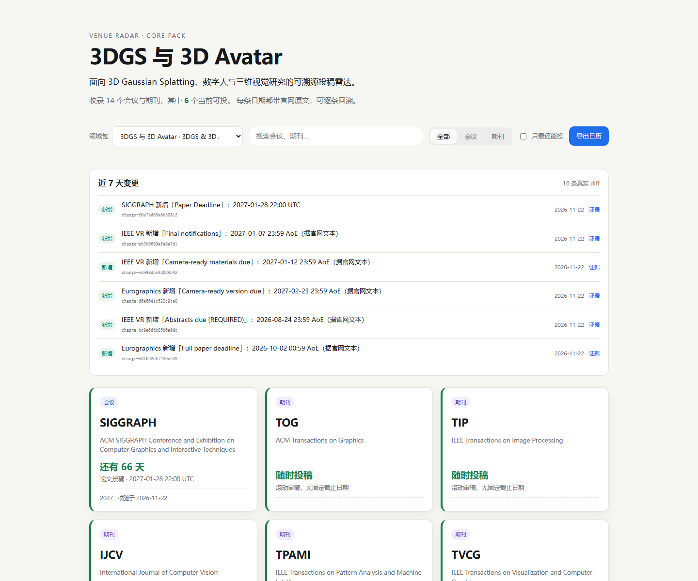
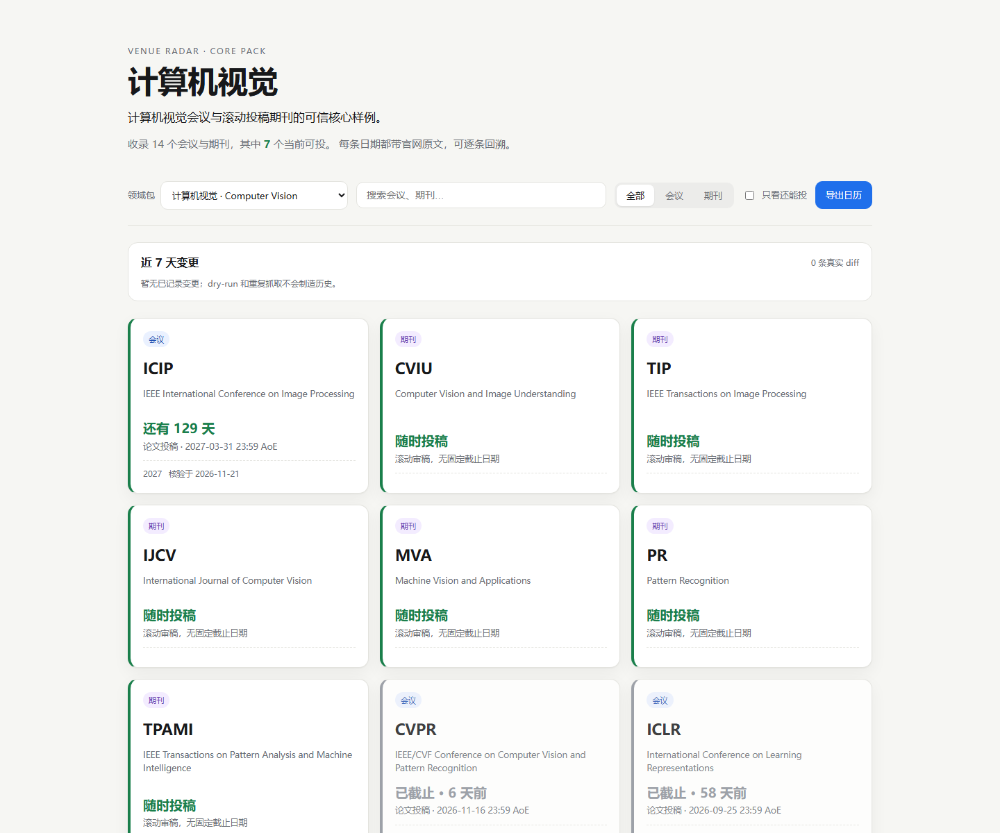

# Venue Radar

[English](README.en.md) | 中文

**开源、可自托管的会议 / 期刊投稿雷达。** 它把官网上的日期变成一份可查询、可回验、可订阅，也能交给自己的 agent 维护的数据集。

> **Venue Radar 不绑定 CV。** 仓库里的 Computer Vision 与 3DGS / Avatar 只是随仓库提供的样例：前者用来展示广度，后者用来展示一个垂直领域可以做到多深。医学 CV、HCI、机器人、计算生物学或任何其他领域，都可以用同一套机制建立自己的领域包。

<p align="center">
  
</p>

<p align="center"><em>首页直接回答：这个领域接下来能投什么、最近哪些日期变了、每条信息的证据在哪里。</em></p>

---

## 它到底解决什么问题

如果你正在准备一篇论文，真正麻烦的通常不是“搜不到会议”，而是：

- 我这个方向，**未来三个月还有哪些会 / 期刊能投**？哪个截止最近？
- 上周看到的日期是 11 月 16 日，**现在延期了吗**？
- 这条日期**来自官网哪一行、什么时候核对的**？我能自己验证吗？
- 同一份截止日期，**怎么同步到 Windows / Outlook / Google Calendar**？
- 明年换一个课题，**这套东西还能不能复用**？

Venue Radar 把这些问题落成仓库里的数据、采集器、校验器、Web 界面、CLI 和日历文件，而不是一次性的聊天回答。

---

## 仓库里有什么

| 部分 | 作用 |
|---|---|
| `data/venues/*.yaml` | 真正的数据：一个会议或期刊一个 YAML，包含届次与截止节点 |
| `data/snapshots/` | 官网页面的内容寻址快照，用来逐字回验 `evidence.quote` |
| `data/fields/*.yaml` | 领域包：声明“这个方向关心哪些 venue”，不复制日期 |
| `sources/registry.yaml` | 每个 venue 的官方信源与抓取频率 |
| `acquire/` + `cmd/update.ts` | 抓官网、抽取、diff、写回、记录变更 |
| `core/` | schema、时区换算、查询、确定性筛选、变更摘要 |
| `src/` | 可切换领域包的 React 货架界面 |
| `cmd/` + `mcp/` | 给脚本和 agent 的 CLI / MCP 查询层 |
| `skills/` + `docs/AGENT_ONBOARDING.md` | 用户自带 agent 的接入手册与可复制 skill |

**一句话：数据不是模型记忆，而是可 review 的 Git 文件；模型可以帮你找、读、起草，但不能绕过证据闸门直接写日期。**

---

## 为什么不直接问 agent？

如果你只想临时问一句“CVPR 明年什么时候截稿”，**直接问 agent 更省事**。Venue Radar 不是更好的聊天模型，它解决的是另一类问题：**需要反复使用、需要可信、需要团队共享、需要感知变化的投稿情报。**

| | 直接问 agent | Venue Radar |
|---|---|---|
| 信息来源 | 模型记忆 + 当场搜索，过程通常不可复现 | 固定的官方 `sources/registry.yaml` + 内容寻址快照 |
| 日期可信度 | 可能混合旧信息、聚合站或猜测 | 每条日期必须带官网 `quote`，且能在快照逐字命中 |
| 变化感知 | 下次再问，未必知道中间改过什么 | `changelog` 记录真实 `added` / `changed` / `removed` |
| 持久性 | 对话结束就散了 | YAML 留在仓库里，可查询、可 diff、可 fork |
| 团队协作 | 很难 review “它为什么这么答” | PR 的 diff 就是审核界面 |
| 日历 | 通常还要手工抄 | 当前筛选一键导出 `.ics`，构建后还可订阅 |
| 更换模型 | 提示词和行为可能漂移 | 数据契约与校验器不变，换 agent 即可 |
| 领域扩展 | 每次重新解释背景 | 建一个领域包，长期复用同一套 venue 数据 |

**最适合用 Venue Radar 的场景：** 实验室或团队要维护一份可信的投稿日历；你每年反复投同一批会议；你希望 agent 帮你扩展新领域，但不想让它编日期。

**不适合的场景：** 让模型判断“哪本期刊更容易中”“哪个会议更有影响力”“我的论文适合投哪里”。这些需要审稿口味、影响因子、接受率、导师偏好等数据，当前仓库**不提供，也不假装提供**。

---

## 一个医学 CV 使用者的完整路径

假设你做医学图像分割，想长期跟踪 MICCAI、MIDL、IPMI、ISBI、IEEE TMI、Medical Image Analysis 等 venue。下面是从零开始的真实使用方式。

### 1. 下载并打开仓库

```bash
git clone https://github.com/qianlian-mozi/conference_journal_tool.git venue-radar
cd venue-radar
npm install
npm run dev
```

浏览器打开 `http://localhost:5173/?pack=3dgs-avatar` 可以先看样例效果。需要 Node.js ≥ 22。

### 2. 在仓库目录里打开你的 agent

Claude Code、Codex、DSH、Cursor 或任何能读文件、执行命令、访问网页的 agent 都可以。**不需要把 API key 放进仓库。**

先只做调研，不要让 agent 写文件：

```text
你在一个 Venue Radar 仓库中工作。先阅读 AGENTS.md、docs/PACKS.md、
docs/AGENT_ONBOARDING.md 和 skills/venue-onboarding/SKILL.md。

我的研究方向是医学图像分割 / 医学 CV。
我关心的 venue 包括 MICCAI、MIDL、IPMI、ISBI、IEEE TMI、
Medical Image Analysis，也可以补充你认为相关的核心会议/期刊。

这一轮只做调研，不要修改文件，不要执行任何 --write：
1. 先用 node cmd/query.ts --json 检查哪些已经收录。
2. 对未收录的 venue，找官方主页和最近一届的 Dates / CFP 页面。
   只把官方页面作为证据，聚合站只能作为线索。
3. 输出一张表：venue、类型、官网、当届 Dates URL、论文截止是否已公布、
   页面结构（表格/文本/需要新 adapter）、当前缺口。
4. 未公布或无法确认就写“未公布 / 需人工确认”，绝不补日期、时区或 UTC。
5. 最后建议 8–12 个核心 venue，并告诉我先接哪 3 个。
```

它会读仓库里的硬规则，而不是凭印象回答。你会得到一份**带官网链接和缺口说明的候选表**。

### 3. 确认范围，再让 agent 接入

看完候选表后，再给写入授权：

```text
我确认上面的范围。请按 docs/PACKS.md 新建 planned 的 medical-cv 领域包，
再按 AGENTS.md 接入刚才确认的 venue。

先运行 add-venue 预览和 update --dry-run，把命令、抽取到的原文 quote、
警告和 diff 给我。未经我逐条确认，不要执行 --write。
```

这里发生的是：

1. 新建一个领域包，声明“医学 CV 关心哪些 venue”；
2. 为每个 venue 登记官方信源；
3. 抓取官网、生成快照、抽取日期；
4. 把候选 diff 和 quote 交给你审核；
5. 只有通过校验的日期才会进入 YAML。

### 4. 在 Web 里查看并导出日历

```bash
npm run dev
# http://localhost:5173/?pack=medical-cv
```

- 按截止时间、会议/期刊、是否还能投筛选；
- 点开任意条目查看官网原文、快照与核验日期；
- 点“导出日历”，把当前筛选结果下载为 `.ics`，导入 Windows / Outlook / Google / Apple 日历；
- 首页“近 7 天变更”只展示真实的 changelog diff，不展示模型猜测。

### 5. 让它持续更新

把仓库 fork 到自己的 GitHub，启用 Actions。定时任务会抓官网、比对快照、开 PR；你只需要 review PR 里的日期和证据。**不需要模型或 API key，抓取和校验都是确定性 Node 代码。**

完整命令、失败处理和权限边界见 [docs/AGENT_ONBOARDING.md](docs/AGENT_ONBOARDING.md)、[docs/PACKS.md](docs/PACKS.md) 与 [skills/venue-onboarding/SKILL.md](skills/venue-onboarding/SKILL.md)。

---

## 为什么这些日期可信

每条 deadline 长这样：

```yaml
- id: siggraph-2027-paper-deadline
  kind: paper
  label: Paper Deadline
  due: 2027-01-28T22:00:00
  timezone: UTC
  due_utc: 2027-01-28T22:00:00.000Z
  due_source: timestamp
  status: confirmed
  evidence:
    url: https://s2027.siggraph.org/program/technical-papers/
    quote: Thu, 28 Jan 2027 22:00 +00:00 2027-01-28 22:00
    fetched_at: 2026-11-22
    snapshot_hash: <sha256>
```

入库前有三道硬闸门：

1. **原文回验**：edition 与每条 deadline 都必须带官网 `quote`，且能在 `data/snapshots/` 对应快照中逐字命中。
2. **时区自校**：`due + timezone` 换算出的 UTC，必须与页面内嵌时间戳或页面明示时区一致；没有时区就不猜。
3. **结构变化不覆盖**：页面改版导致抽取为空时，保留旧数据并报警，不把已有日期清空。

rolling 期刊没有固定截止日期，系统不会给它们编一个“还有 N 天”。

---

## 通用，不绑定 CV

一个**领域包**只做两件事：

1. 在 `data/fields/<pack-id>.yaml` 里声明这个领域的名称、层级和默认状态；
2. 通过 venue 的 `field_ids` 把已有会议/期刊复用到这个包，**不复制日期与证据**。

因此：

- 同一个 MICCAI 可以同时属于 `medical-cv` 和 `computer-vision`；
- 换领域只需要新建 pack，不需要复制整个数据库；
- 新领域可以先从 3–5 个核心 venue 开始，再逐步扩展；
- 仓库内置的 `robotics-learning` 是一个 planned 包样板，可以复制成你自己的领域。

领域包契约、`core/community/local` 层级和验收清单见 [docs/PACKS.md](docs/PACKS.md)。

<p align="center">
  
</p>

<p align="center"><em>同一个界面切换领域包即可复用 venue；数据只有一份，领域只是视图。</em></p>

---

## 快速开始

```bash
git clone https://github.com/qianlian-mozi/conference_journal_tool.git venue-radar
cd venue-radar
npm install

npm run dev          # 本地 Web 界面
npm run validate     # schema + 时区 + 原文回验
npm run update:dry   # 抓官网，看看会改什么（不落盘）
npm run query -- --open --json
npm run ask -- "未来三个月还能投的会议"
npm run changes -- --days 7
```

没有账号、没有后端数据库、没有默认 LLM 调用。数据就是仓库里的 YAML；快照就是证据。

---

## 给 agent 使用

### CLI / MCP

```bash
npm run query -- --within 90 --json
npm run query -- --venue cvpr --json
npm run ask -- "有没有随时可以投的期刊"
npm run changes -- --days 30 --json
```

MCP server 是只读的，适合让 agent 查询已有数据：

```json
{
  "mcpServers": {
    "venue-radar": {
      "command": "node",
      "args": ["<仓库绝对路径>/mcp/server.ts"]
    }
  }
}
```

它暴露 `search_venues`、`get_venue`、`get_deadlines`，返回值原样保留 `evidence`。

### 接入新 venue

```bash
npm run add-venue -- https://example.org/2027/dates \
  --field medical-cv --id example --short EXAMPLE --full "Example Conference"
# 预览无误后
npm run add-venue -- --write https://example.org/2027/dates \
  --field medical-cv --id example --short EXAMPLE --full "Example Conference"

npm run update:dry -- --venue example
# 检查 diff、quote 和警告后
npm run update -- --venue example
npm run validate
```

`add-venue` 默认只预览，不生成任何日期。详细参数与手工兜底见 [docs/ADD_A_VENUE.md](docs/ADD_A_VENUE.md)。

---

## 自动更新怎么工作

```text
sources/registry.yaml
        │
        ▼
抓取官网 ──► 规范化文本快照（sha256）──► 与上次相同？──是──► 结束
        │                                      │否
        ▼                                      ▼
   确定性适配器抽取 ──► 字段级 diff ──► quote/时区闸门 ──► YAML + changelog
                                                         │
                                                         ▼
                                                  PR / 日历 / Web
```

- GitHub Actions 每周运行，也支持手动触发；
- 只有真实变化才写 `data/changelog.yaml`；
- 抽取失败或结构变化时保留旧数据；
- 模型可以帮忙写新 adapter，但 adapter 必须通过快照、quote 与时区测试才能合入。

当前适配器覆盖 CVF / NeurIPS 模板、原生与 ARIA 表格、主会文本区块、SIGGRAPH widget 和日期时间线。**不认识的新站点不会被硬塞进错误模板**，而是要求新增 adapter 或人工补证据。

---

## 命令

| 命令 | 作用 |
|---|---|
| `npm run validate` | 校验全部数据：schema、时区、edition/deadline 双层 quote 回验、changelog |
| `npm run update:dry` | 抓官网并打印将要发生的变更 |
| `npm run update` | 抓官网并写回 YAML、快照与 changelog |
| `npm run add-venue -- <url> ...` | 预览新 venue 骨架与源登记（`--write` 落盘） |
| `npm run discover -- <关键词>` | 在领域候选清单里找未收录 venue |
| `npm run query -- --open --json` | 查询仍可投稿的 venue，保留全部届次与证据 |
| `npm run ask -- "<问题>"` | 确定性自然语言筛选（不调用模型） |
| `npm run changes -- --days 7` | 把真实 changelog diff 摘要成带证据的文本 |
| `npm run mcp` | 启动只读 MCP stdio server |
| `npm run test:all` | 全部单元测试与 CLI 集成测试 |

---

## 目录

```text
core/         schema、领域包、时区、查询、确定性筛选、变更摘要
acquire/      抓取、快照、适配器与更新入口
cmd/          validate / update / query / ask / changes / add-venue / discover
mcp/          零依赖 MCP stdio server
data/         fields/ 领域包、venues/ 数据、snapshots/ 快照、discovery/ 候选、changelog
sources/      registry.yaml 官方信源
skills/       可复制给 agent 的 venue-onboarding skill
src/          React 货架界面与日历导出
tests/        数据、适配器、CLI、UI 与 agent 契约测试
docs/         规划、领域包、接入、变更、日历与实测记录
```

更多文档：

- [领域包契约](docs/PACKS.md)
- [agent 接入流程](docs/AGENT_ONBOARDING.md)
- [新 venue 接入](docs/ADD_A_VENUE.md)
- [候选发现](docs/DISCOVER.md)
- [变更日志](docs/CHANGELOG.md) / [变更摘要](docs/CHANGES.md)
- [日历导出](docs/CALENDAR.md)
- [贡献指南](CONTRIBUTING.md)

---

## 当前状态

- **数据**：12 个会议 + 8 个 rolling 期刊，20 个 venue，57 条 deadline。
- **样例包**：3DGS / Avatar（默认）、Computer Vision、Robotics Learning（planned 样板）。
- **界面**：领域包切换、截止排序、状态筛选、证据详情、近 7 天变更、ICS 导出。
- **Agent**：CLI、只读 MCP、AGENTS.md、可复制 skill、外部用户接入实测。
- **未完成**：论文→会议匹配、影响因子/接受率等主观推荐、更多出版商适配器。

---

## 数据原则

- 官方来源优先；**没有出处的日期不入库**。
- 官方事实、第三方统计、个人经验分开记录，不合成一个分数。
- 未核验或未公布的信息明确显示“未公布”，不用占位数据冒充。
- 抓取遵守 robots.txt，串行、限速，只抓 CFP / Dates / 官方入口页面。

## 免责声明

本项目提供的信息仅供科研参考，不构成投稿建议。会议与期刊的截止日期可能随时调整，请以官方网站最新公告为准。

## License

代码 MIT，见 [LICENSE](./LICENSE)。
